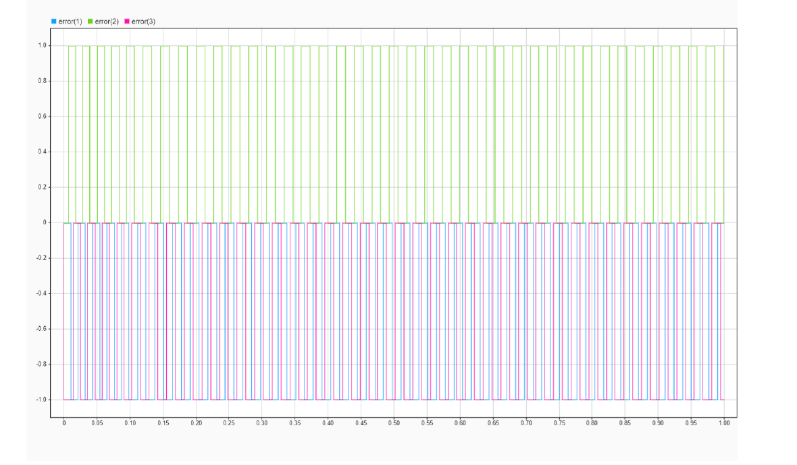
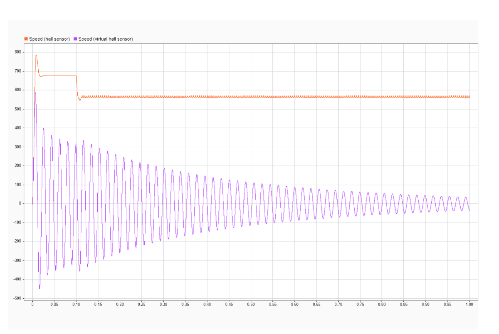
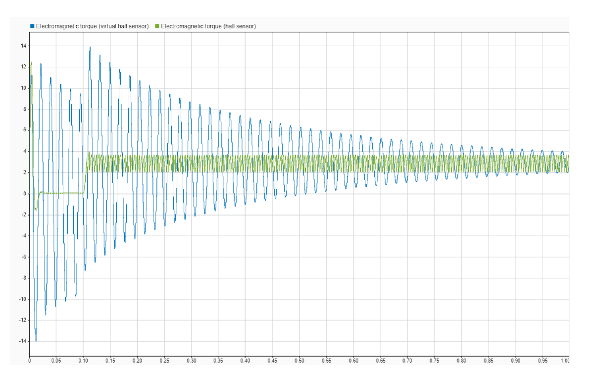

# BLDC Motor Control with Mathematically Generated Hall Signals

A MATLAB/Simulink implementation of BLDC motor control that derives virtual Hall sensor signals from the rotor's mechanical angle.

## Overview

The `hallSensorGenerator` MATLAB Function converts rotor mechanical angle to electrical angle and maps it to the six Hall states used for 120-degree BLDC commutation. The virtual signals feed the model's commutation decoder in place of physical Hall inputs.

## Hall signal generation

The electrical angle is calculated as:

```text
theta_e = mod(theta_m * pole_pairs, 2*pi)
```

The generated signal ranges are:

| Electrical angle | Hall A | Hall B | Hall C |
| --- | ---: | ---: | ---: |
| 0-60 degrees | 1 | 0 | 1 |
| 60-120 degrees | 1 | 0 | 0 |
| 120-180 degrees | 1 | 1 | 0 |
| 180-240 degrees | 0 | 1 | 0 |
| 240-300 degrees | 0 | 1 | 1 |
| 300-360 degrees | 0 | 0 | 1 |

This yields the six-state sequence `101 -> 100 -> 110 -> 010 -> 011 -> 001` for increasing electrical angle.

## Simulation results

The generated Hall signals reproduce the same six-state commutation sequence as the physical Hall sensors, confirming the sector-mapping logic. A small phase shift between the signal sets indicates a commutation delay.


*Figure 1: Comparison between actual Hall sensor signals and virtually generated Hall sensor signals showing a small commutation delay.*

Compared with physical Hall-sensor feedback, the virtual-Hall implementation produces greater speed and torque oscillations and a slower settling response. This shows that mathematically generated Hall signals can reproduce the required commutation pattern, while signal timing remains important for comparable dynamic performance.


*Figure 2: Comparison of motor speed response using physical Hall sensors and virtual Hall sensors.*


*Figure 3: Comparison of motor torque response using physical Hall sensors and virtual Hall sensors.*

## Files

- `posn_sensor.slx` - Simulink model containing the BLDC motor and virtual Hall sensor implementation.
- `hallSensorGenerator.m` - MATLAB function that generates the three Hall signals.
- `docs/figures/` - Result plots embedded in this README.

## Function details

```matlab
[HallA, HallB, HallC] = hallSensorGenerator(theta_rad, pole_pairs)
```

- `theta_rad`: rotor mechanical angle in radians.
- `pole_pairs`: motor pole-pair count.
- `HallA`, `HallB`, `HallC`: binary virtual Hall outputs.

## Related

[Sensorless Control of BLDC Motor Using ANFIS](https://github.com/vjkhtw/BLDC-motor-control-using-ANFIS) (follow-up project).
